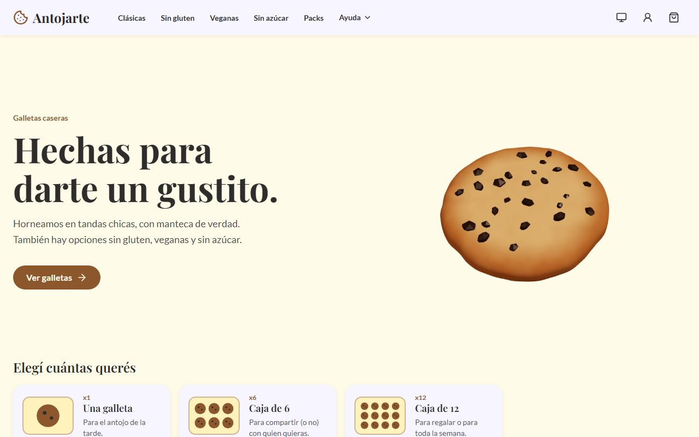
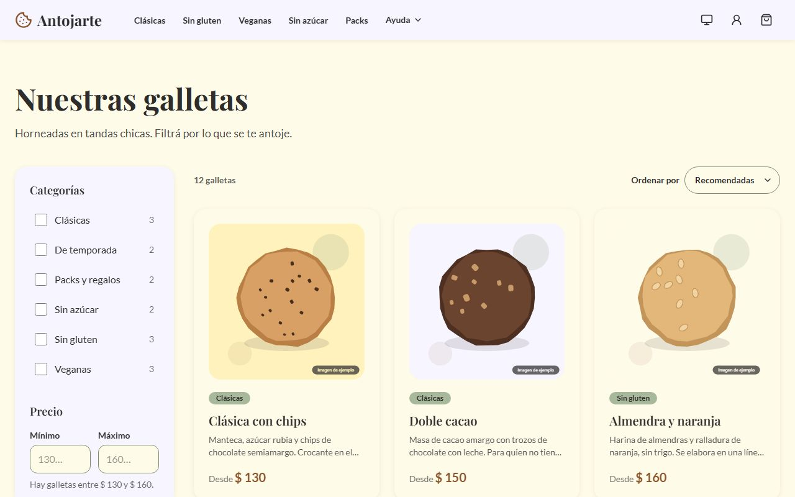
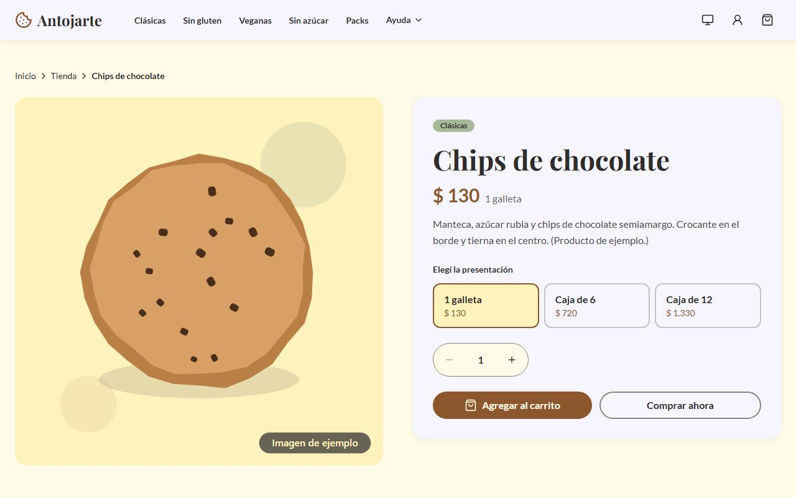
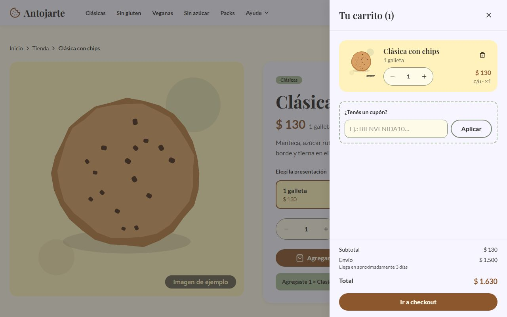
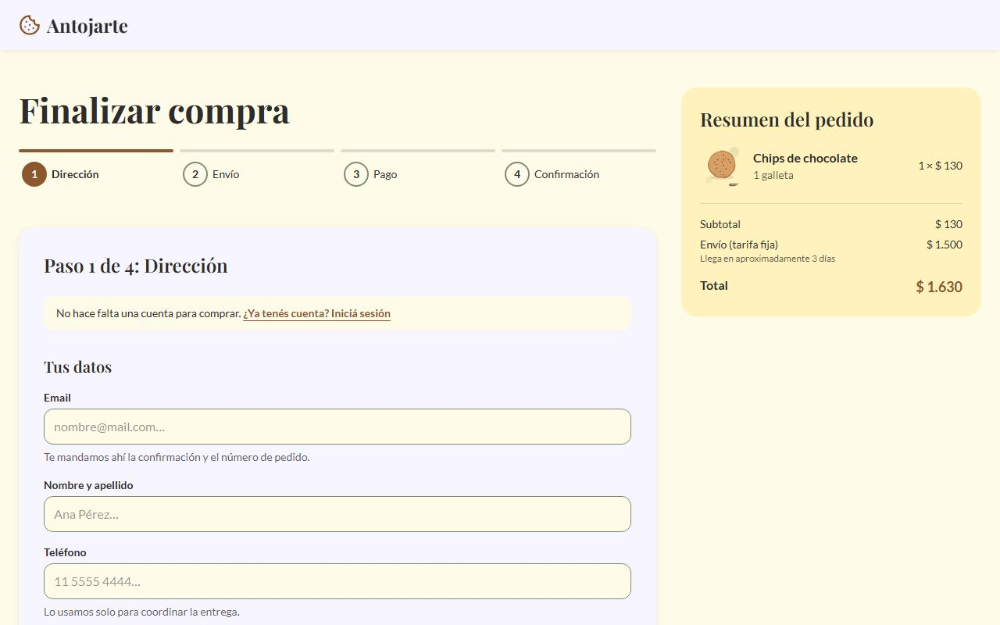
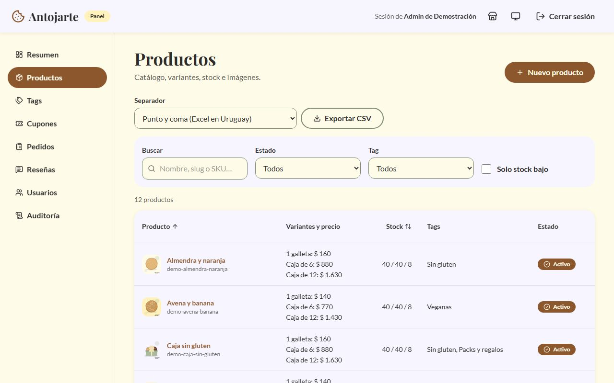
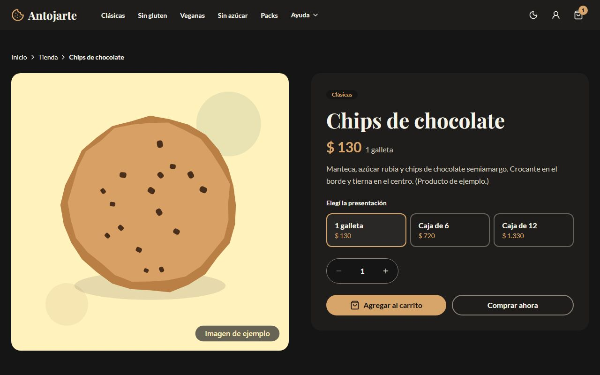
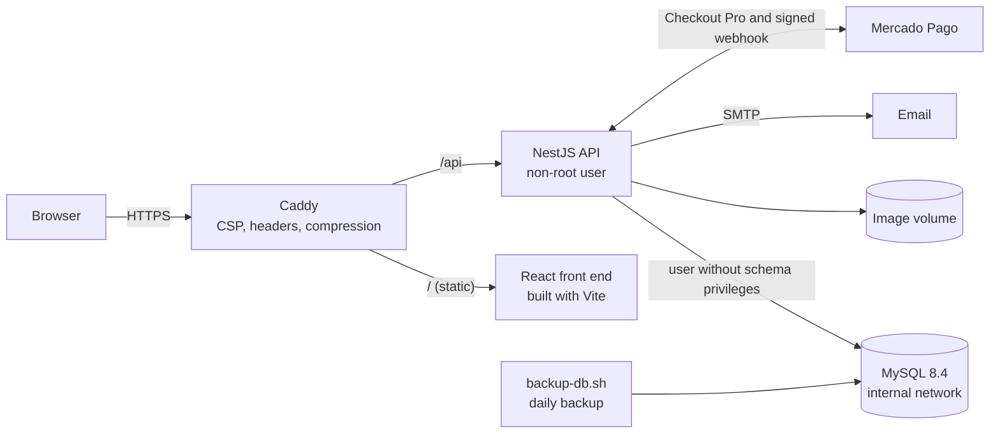
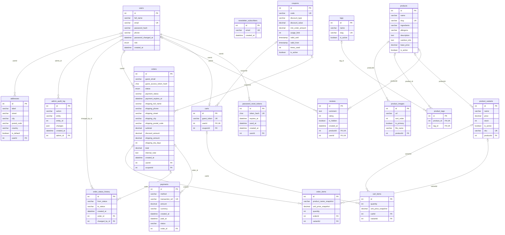

# Antojarte

[Versión en español](README.md)

An online shop for homemade cookies, built end to end as a practice project:
- catalog with filters;
- cart for guests and signed-in customers;
- four-step checkout;
- Mercado Pago payments (simulated for now);
- order emails;
- admin panel with an audit log and CSV export;
- deployment with Docker, Caddy and HTTPS.

The interface is in Spanish (Uruguay).

> **Practice project.** The "Antojarte" brand, the products, prices and reviews are examples. It is not a real shop and it does not charge anything.

| | |
|---|---|
|  |  |
| **Home.** A 3D cookie (Three.js) over a still image that loads instantly | **Shop.** Category and price filters, kept in the URL |
|  |  |
| **Product page.** x1/x6/x12 variants, allergens and reviews | **Cart.** Side drawer with coupons; the server computes every amount |
|  |  |
| **Checkout.** Four steps, with or without an account | **Admin panel.** Orders, catalog, coupons, reviews and audit log |
|  | |
| **Dark mode.** Its own palette, AA contrast | |

Screenshots of the real app with the demo data (`pnpm seed:demo`), at 1280 px.

## Stack

| Part | Technology |
|---|---|
| Front end | React 19, TypeScript, Vite 8, Tailwind CSS 4, Zustand, React Router, GSAP, Three.js (React Three Fiber) |
| API | NestJS 11, TypeORM 1, MySQL 8.4, Passport JWT, class-validator, Nodemailer |
| Payments | Mercado Pago Checkout Pro (test mode; simulated for now) |
| Infrastructure | Docker Compose, Caddy (HTTPS, CSP and static files), GitHub Actions, Dependabot |
| Tests | Jest and Supertest (API), Vitest and Testing Library (front end), Playwright with axe-core (end-to-end and accessibility), Lighthouse |

## Architecture



- **Amounts:** the front end never computes a total. The API recomputes prices, coupons and shipping at every step and takes stock with a row lock.
- **Production:** the database publishes no ports and the API does not run as root. Details in [despliegue.md](Antua/antua-web/docs/despliegue.md) (Spanish).
- **Technical decisions:** the reasons for each one are in [decisiones.md](Antua/antua-web/docs/decisiones.md) (Spanish).

## Run it locally

Requirements: **Node.js 24**, **pnpm 10** (`npm i -g pnpm@10`) and **Docker**.

```bash
git clone <this-repo-url> antojarte
cd antojarte/Antua
pnpm install

# Local configuration. The examples already work together; for anything beyond a quick try,
# change DB_PASSWORD (the same in both .env files) and JWT_SECRET.
cp .env.example .env
cp antua-api/.env.example antua-api/.env
cp antua-web/.env.example antua-web/.env

docker compose up -d db                      # MySQL on 127.0.0.1:3307
pnpm --filter antua-api migration:run        # creates the tables (the API never migrates by itself)
DEMO_PASSWORD='Demo2026!' pnpm seed:demo     # demo catalog, reviews, coupon and account
pnpm dev                                     # shop: http://localhost:5173 · API: http://localhost:3000
```

In PowerShell, the seed line is `$env:DEMO_PASSWORD='Demo2026!'; pnpm seed:demo`.

Then:
- **Demo account:** sign in as `demo.cliente@antojarte.example` with the password you chose.
- **Sample coupon:** `DEMO10`.
- **Payments:** simulated.
- **Admin panel:** add `DEMO_ADMIN_PASSWORD='…'` to the seed command and open `/admin` as `demo.admin@antojarte.example`.
- **Remove the demo data:** `pnpm seed:demo:clean --yes`.

Variations:
- **Other ports:** `MYSQL_PORT` in `.env`; `DB_PORT` and `PORT` in `antua-api/.env`; `VITE_API_URL` in `antua-web/.env`; and `pnpm dev:web --port 5180`.
- **Everything in Docker:** `docker compose --profile web up -d --build`.
- **Emails in the browser** (Mailpit), **a real admin** and **the development test data:** see [Antua/README.md](Antua/README.md) (Spanish).

## Tests

```bash
cd Antua
pnpm --filter antua-api test          # API, unit
pnpm --filter antua-api test:e2e      # API, end-to-end (needs an empty antua_test database; see Antua/README.md)
pnpm --filter antua-web test          # front end, unit
pnpm --filter antua-web test:e2e      # Playwright flows (needs the API with data)
```

At the end of Phase 16:
- **API:** 136 unit tests and 160 end-to-end tests.
- **Front end:** 61 unit tests, plus the Playwright suites.
- **CI:** continuous integration runs all of this on every pull request, plus lint, type checks, builds and Docker images.

## Quality

| Measurement | Result |
|---|---|
| Lighthouse mobile, performance (median of 3, through the proxy) | Home 96 · Shop 97 · Product 97 |
| Lighthouse desktop, performance | Home 100 · Shop 100 |
| Lighthouse: accessibility, best practices and SEO | 100 on every measured page |
| axe-core | 0 violations in 150 scans: 375 and 1280 px, light and dark, checkout and admin panel |
| Keyboard | 34 of 34 automated walkthroughs |
| Contrast | AA for every palette pair; control borders at 3:1 or more |

Details and method in the [QA report](Antua/antua-web/docs/qa/informe-qa.md) (Spanish).

## Security

The Phase 16 review backs every claim with evidence (a test, a request or a tool's output). It is in [seguridad.md](Antua/antua-web/docs/seguridad.md) (Spanish). In short:

- **Authorization:** an IDOR matrix tests every route that takes an id (someone else → 404, signed out → 401) and fails if a new route has no test. Responses are checked against an allowlist of fields.
- **Sessions:** HS256 JWTs that expire and are invalidated by a password change. The role is read from the database on every request. Login does not reveal whether an email exists, and spoofed headers do not bypass the rate limit.
- **Inputs:** allowlists for sorting and filters, undeclared fields are rejected, uploads are validated by content (no SVG), and stored HTML is always rendered as text.
- **Production:** CSP without `unsafe-*`, non-root API, database without published ports, an application user without schema privileges, and errors without internal details.
- **Dependencies:** no advisories in production code. New versions are accepted only after 7 days, and a scan of the Git history found no secrets.
- **Pending decisions:** keeping the token in an `httpOnly` cookie, revoking sessions on sign-out, enabling Dependabot alerts and running Caddy as non-root. See "Resumen de hallazgos" (findings summary).

## Known limitations

- **Simulated payments.** The Mercado Pago Checkout Pro integration is built and tested with simulated signatures, but there are no credentials: no payment is real. It only accepts test credentials ([how to try it](Antua/antua-web/docs/mercadopago-prueba.md), Spanish).
- **Example brand and copy.** "Antojarte" is fictional. The contact address (`contacto@antojarte.example`) does not exist, and the legal pages have not been reviewed by a lawyer.
- **No SSR.** It is a single-page app: search engines get `sitemap.xml`, `robots.txt` and structured data, but the content is rendered in the browser.
- **No email verification.** Accounts do not confirm their email. That is why a guest order is never linked by email, only with its token, and why sign-up says when an email is already registered (see seguridad.md).
- **The session token lives in `localStorage`.** The mitigations are tested; the cookie alternative is documented and pending a decision.
- **One language and one currency:** Spanish (Uruguay) and Uruguayan pesos.
- **Real-phone measurement:** the 3D scene has not been measured on a phone with a GPU (Lighthouse has none).

## Data model

Generated from the TypeORM entities with `pnpm --filter antua-api docs:er` (not drawn by hand).

<!-- er:start -->

<!-- er:end -->

## More documentation (Spanish)

| Document | Contents |
|---|---|
| [Antua/README.md](Antua/README.md) | Development guide: commands, migrations, test data, structure |
| [decisiones.md](Antua/antua-web/docs/decisiones.md) | Technical decisions, with the alternatives and the reasons |
| [despliegue.md](Antua/antua-web/docs/despliegue.md) | Production step by step: Docker, HTTPS, backups, logs, health |
| [seguridad.md](Antua/antua-web/docs/seguridad.md) | Security review with evidence |
| [migraciones-pendientes.md](Antua/antua-web/docs/migraciones-pendientes.md) | Proposed migrations, with measured EXPLAIN output |
| [admin.md](Antua/antua-web/docs/admin.md) | Admin panel: roles, endpoints and order statuses |
| [creditos.md](Antua/antua-web/docs/creditos.md) | Licenses of dependencies, fonts, icons and GSAP |

## License

This repository **has no license yet**. Until it has one, you can read the code, but you may not reuse it without permission.
