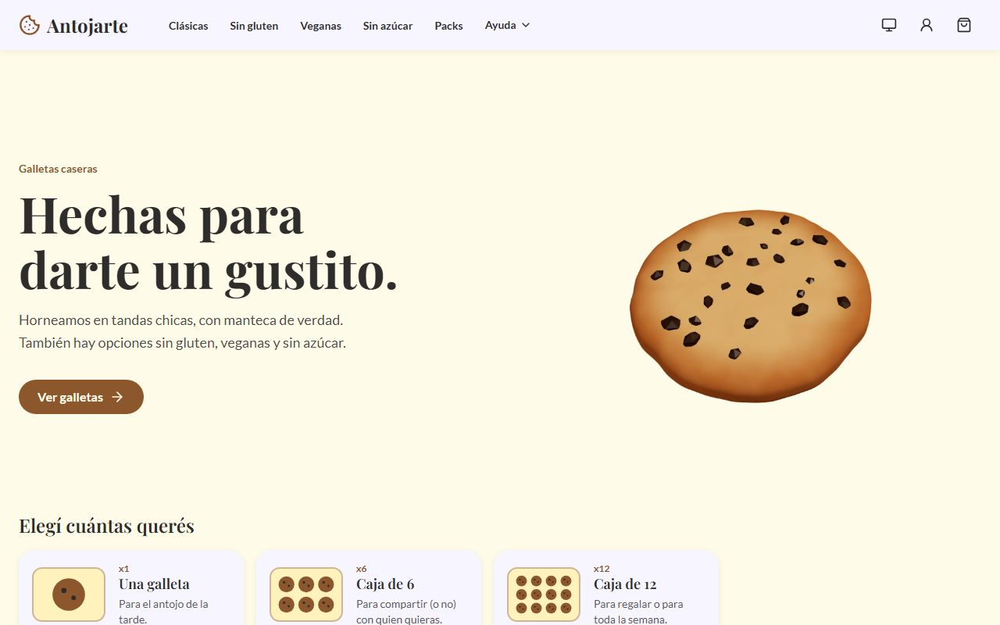
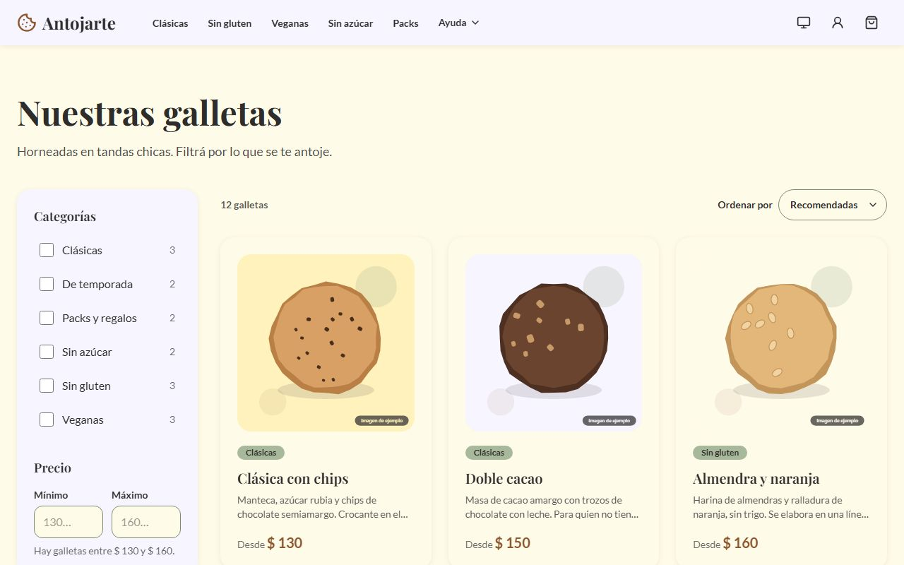
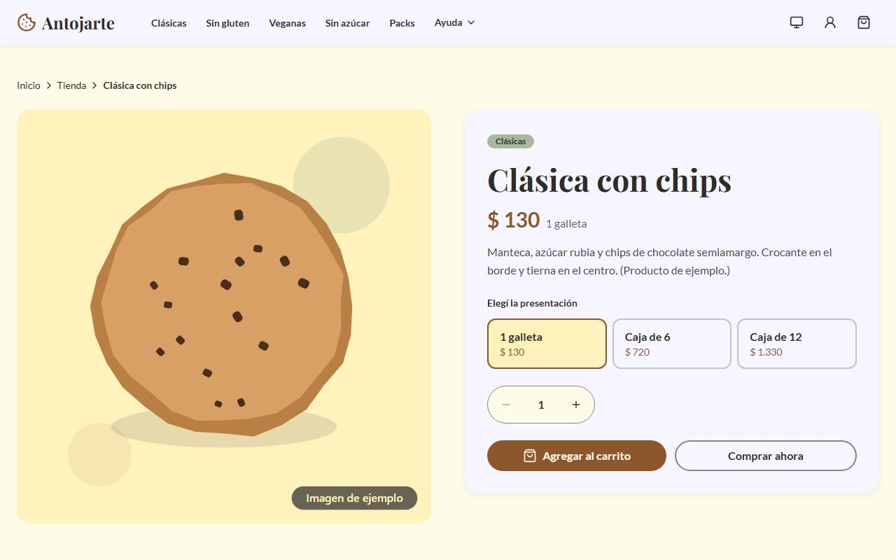
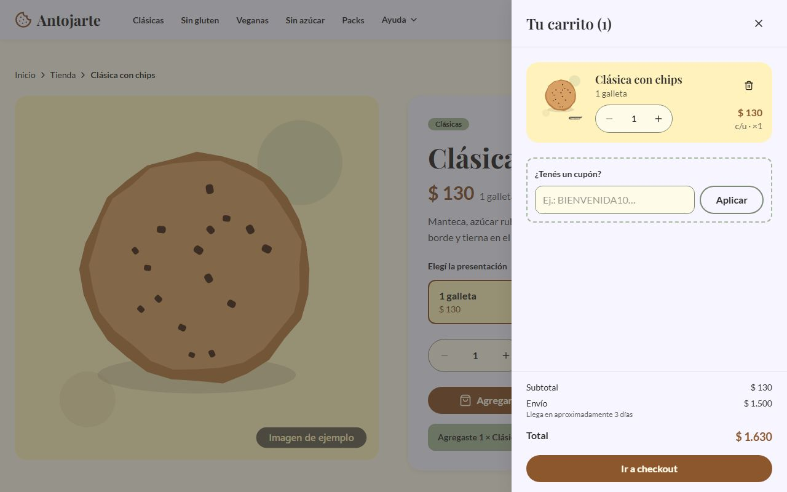
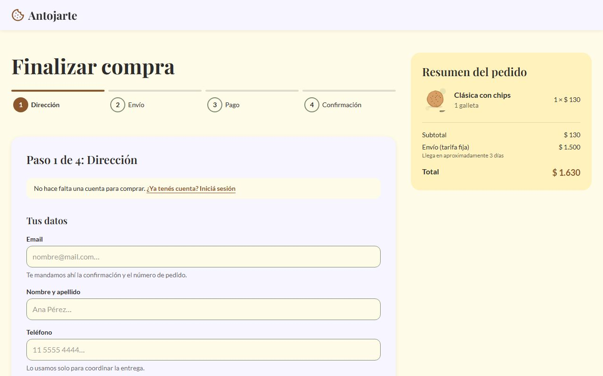
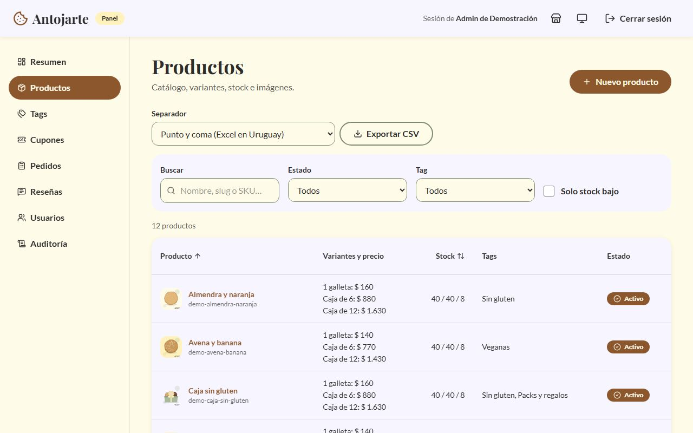
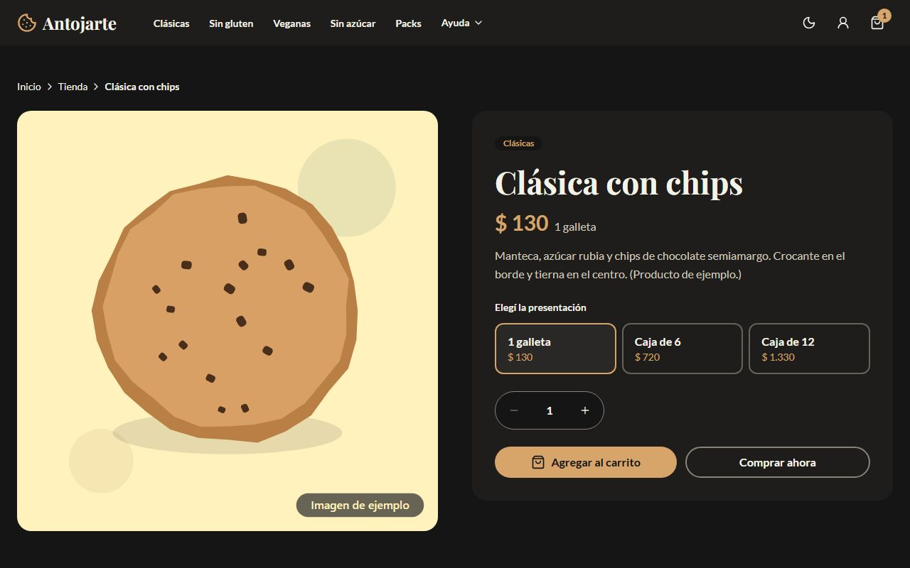
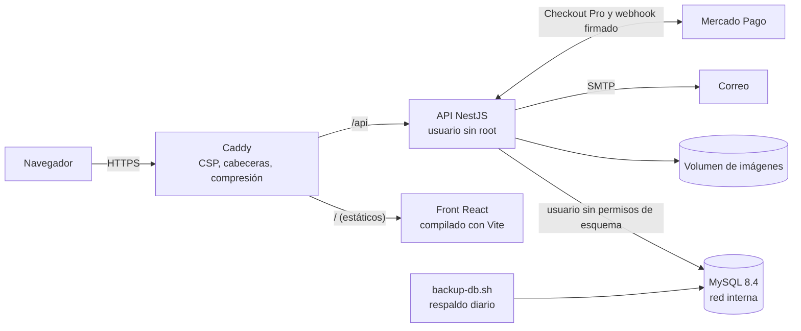
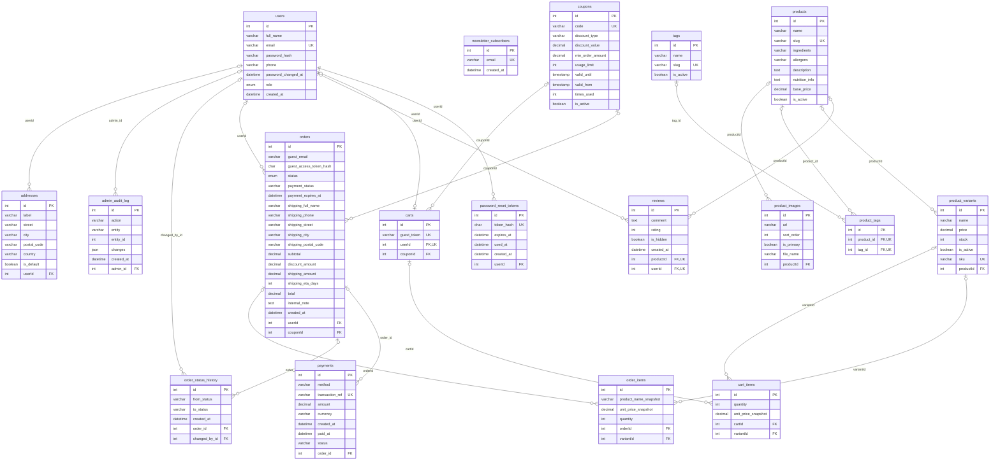

# Antojarte

[English version](README.en.md)

Tienda online de galletas caseras, hecha de punta a punta como proyecto de práctica:
- catálogo con filtros;
- carrito para invitados y con cuenta;
- checkout en cuatro pasos;
- pagos con Mercado Pago (hoy simulados);
- correos de pedido;
- panel de administración con auditoría y exportación a CSV;
- despliegue con Docker, Caddy y HTTPS.

> **Proyecto de práctica.** La marca "Antojarte", los productos, los precios y las reseñas son de ejemplo. No es una tienda real y no cobra nada.

| | |
|---|---|
|  |  |
| **Home.** Galleta en 3D (Three.js) sobre una imagen fija que carga al instante | **Tienda.** Filtros por categoría y precio, en la URL |
|  |  |
| **Ficha.** Variantes x1/x6/x12, alérgenos y reseñas | **Carrito.** Lateral, con cupón; el servidor calcula los montos |
|  |  |
| **Checkout.** Cuatro pasos, con o sin cuenta | **Panel.** Pedidos, catálogo, cupones, reseñas y auditoría |
|  | |
| **Modo oscuro.** Paleta propia, con contraste AA | |

Las capturas son de la app real con los datos de demostración (`pnpm seed:demo`), a 1280 px.

## Stack

| Parte | Tecnología |
|---|---|
| Front | React 19, TypeScript, Vite 8, Tailwind CSS 4, Zustand, React Router, GSAP, Three.js (React Three Fiber) |
| API | NestJS 11, TypeORM 1, MySQL 8.4, Passport JWT, class-validator, Nodemailer |
| Pagos | Mercado Pago Checkout Pro (modo prueba; hoy simulado) |
| Infraestructura | Docker Compose, Caddy (HTTPS, CSP y estáticos), GitHub Actions, Dependabot |
| Tests | Jest y Supertest (API), Vitest y Testing Library (front), Playwright con axe-core (e2e y accesibilidad), Lighthouse |

## Arquitectura



- **Montos:** el front nunca calcula un total. La API recalcula precios, cupones y envío en cada paso y descuenta el stock con bloqueo de fila.
- **Producción:** la base no publica puertos y la API corre sin root. Detalle en [despliegue.md](Antua/antua-web/docs/despliegue.md).
- **Decisiones técnicas:** el porqué de cada una está en [decisiones.md](Antua/antua-web/docs/decisiones.md).

## Correrlo en tu máquina

Requisitos: **Node.js 24**, **pnpm 10** (`npm i -g pnpm@10`) y **Docker**.

```bash
git clone <url-de-este-repo> antojarte
cd antojarte/Antua
pnpm install

# Configuración local. Los ejemplos ya funcionan juntos; para algo más que probar,
# cambiá DB_PASSWORD (la misma en los dos .env) y JWT_SECRET.
cp .env.example .env
cp antua-api/.env.example antua-api/.env
cp antua-web/.env.example antua-web/.env

docker compose up -d db                      # MySQL en 127.0.0.1:3307
pnpm --filter antua-api migration:run        # crea las tablas (la API no migra sola)
DEMO_PASSWORD='Demo2026!' pnpm seed:demo     # catálogo, reseñas, cupón y cuenta de demostración
pnpm dev                                     # tienda: http://localhost:5173 · API: http://localhost:3000
```

En PowerShell, la línea del seed es `$env:DEMO_PASSWORD='Demo2026!'; pnpm seed:demo`.

Con eso:
- **Cuenta de demostración:** entrás con `demo.cliente@antojarte.example` y la contraseña que elegiste.
- **Cupón de ejemplo:** `DEMO10`.
- **Pagos:** se simulan.
- **Panel:** suma `DEMO_ADMIN_PASSWORD='…'` al seed y entrá a `/admin` con `demo.admin@antojarte.example`.
- **Borrar lo de demo:** `pnpm seed:demo:clean --yes`.

Variantes:
- **Otros puertos:** `MYSQL_PORT` en `.env`; `DB_PORT` y `PORT` en `antua-api/.env`; `VITE_API_URL` en `antua-web/.env`; y `pnpm dev:web --port 5180`.
- **Todo en Docker:** `docker compose --profile web up -d --build`.
- **Correos en el navegador** (Mailpit), **admin real** y **datos de prueba de desarrollo:** guía completa en [Antua/README.md](Antua/README.md).

## Tests

```bash
cd Antua
pnpm --filter antua-api test          # API, unitarios
pnpm --filter antua-api test:e2e      # API, e2e (necesita una base vacía antua_test; ver Antua/README.md)
pnpm --filter antua-web test          # front, unitarios
pnpm --filter antua-web test:e2e      # flujos con Playwright (necesita la API con datos)
```

Al cierre de la Fase 16:
- **API:** 131 tests unitarios y 160 e2e.
- **Front:** 61 unitarios, más los e2e de Playwright.
- **CI:** la integración continua corre todo esto en cada PR, además de lint, tipos, build e imágenes de Docker.

## Calidad

| Medición | Resultado |
|---|---|
| Lighthouse móvil, rendimiento (mediana de 3, por el proxy) | Home 96 · Tienda 97 · Ficha 97 |
| Lighthouse escritorio, rendimiento | Home 100 · Tienda 100 |
| Lighthouse: accesibilidad, buenas prácticas y SEO | 100 en todas las páginas medidas |
| axe-core | 0 violaciones en 150 análisis: 375 y 1280 px, claro y oscuro, checkout y panel |
| Teclado | 34 de 34 recorridos automatizados |
| Contraste | AA en todos los pares de la paleta; bordes de controles a 3:1 o más |

Detalle y método en el [informe de QA](Antua/antua-web/docs/qa/informe-qa.md).

## Seguridad

La revisión de la Fase 16 tiene evidencia para cada afirmación (un test, una request o la salida de una herramienta). Está completa en [seguridad.md](Antua/antua-web/docs/seguridad.md). En resumen:

- **Autorización:** una matriz de IDOR prueba cada ruta con id (otra persona → 404, sin sesión → 401) y falla si aparece una ruta nueva sin test. Las respuestas se comparan contra una lista de campos permitidos.
- **Sesiones:** JWT HS256 que vencen y se invalidan al cambiar la contraseña. El rol se lee de la base en cada request. El login no revela si un email existe, y el límite de intentos no se esquiva con cabeceras falsas.
- **Entradas:** listas blancas en orden y filtros, rechazo de campos no declarados, subidas validadas por contenido (sin SVG) y HTML guardado que siempre se muestra como texto.
- **Producción:** CSP sin `unsafe-*`, API sin root, base sin puertos publicados, usuario de aplicación sin permisos de esquema y errores sin detalles internos.
- **Dependencias:** sin avisos en el código de producción. Versiones nuevas recién después de 7 días, y un escaneo del historial de Git sin secretos.
- **Pendiente de decisión:** guardar el token en una cookie `httpOnly`, revocar sesiones al cerrar sesión, activar las alertas de Dependabot y correr Caddy sin root. Ver la sección "Resumen de hallazgos".

## Limitaciones conocidas

- **Pagos simulados.** La integración con Mercado Pago Checkout Pro está hecha y probada con firmas simuladas, pero no hay credenciales: ningún pago es real. Solo admite credenciales de prueba ([cómo probarla](Antua/antua-web/docs/mercadopago-prueba.md)).
- **Marca y textos de ejemplo.** "Antojarte" es una marca ficticia. El correo de contacto (`contacto@antojarte.example`) no existe, y los textos legales no los revisó un abogado.
- **Sin SSR.** Es una SPA: los buscadores reciben `sitemap.xml`, `robots.txt` y datos estructurados, pero el contenido se arma en el navegador.
- **Sin verificación de email.** Las cuentas no confirman su correo. Por eso un pedido de invitado nunca se vincula por email, sino con su token, y el registro avisa si el email ya existe (ver seguridad.md).
- **El token de sesión vive en `localStorage`.** Las mitigaciones están probadas; la alternativa con cookie está documentada y pendiente de decisión.
- **Un solo idioma y una moneda:** español de Uruguay y pesos uruguayos.
- **Medición en teléfonos reales:** la escena 3D no se midió en un teléfono con GPU (Lighthouse no tiene).

## Modelo de datos

Generado a partir de las entidades de TypeORM con `pnpm --filter antua-api docs:er` (no está dibujado a mano).

<!-- er:start -->

<!-- er:end -->

## Más documentación

| Documento | Qué tiene |
|---|---|
| [Antua/README.md](Antua/README.md) | Guía de desarrollo: comandos, migraciones, datos de prueba, estructura |
| [decisiones.md](Antua/antua-web/docs/decisiones.md) | Decisiones técnicas, con alternativas y porqué |
| [despliegue.md](Antua/antua-web/docs/despliegue.md) | Producción paso a paso: Docker, HTTPS, respaldos, logs, salud |
| [seguridad.md](Antua/antua-web/docs/seguridad.md) | Revisión de seguridad con evidencia |
| [migraciones-pendientes.md](Antua/antua-web/docs/migraciones-pendientes.md) | Migraciones propuestas, con EXPLAIN medido |
| [admin.md](Antua/antua-web/docs/admin.md) | Panel: roles, endpoints y estados de pedidos |
| [creditos.md](Antua/antua-web/docs/creditos.md) | Licencias de dependencias, fuentes, íconos y GSAP |

## Licencia

Este repositorio todavía **no tiene licencia**. Mientras no la tenga, se puede leer, pero no reutilizar el código sin permiso.
